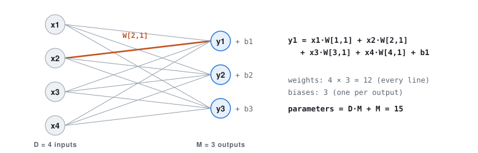
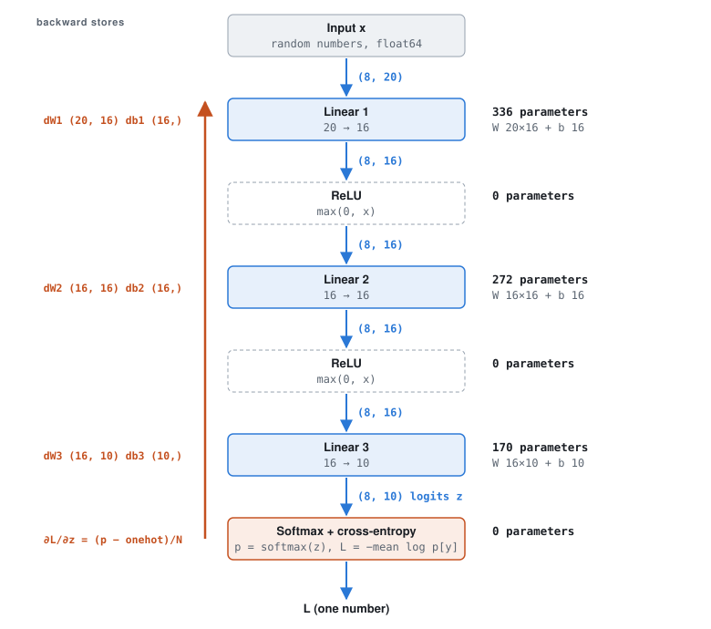
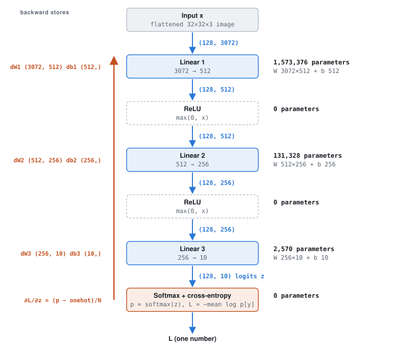
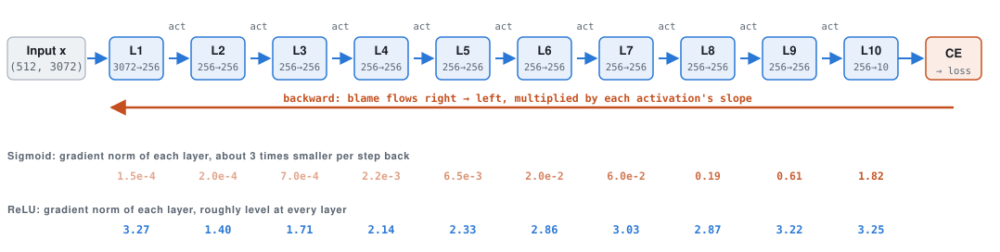

# Task 1: MLP architectures at a glance

Study notes for the three networks used in Task 1. In every diagram, **blue arrows are the forward pass** (data flows down, with its shape on each arrow) and **orange is the backward pass** (blame flows back, and each Linear layer stores `dW`, `db`).

Regenerate the figures with `python notes/task1/make_diagrams.py`.

---

## 0. What one Linear layer is



Every input connects to every output, and **each line is one weight**.

```
Linear(D → M):   y = x W + b
  x : (N, D)    N samples, D features each
  W : (D, M)    one weight per (input, output) pair
  b : (M,)      one bias per output
  y : (N, M)

parameters = D × M + M
ReLU, Sigmoid, Softmax have 0 parameters (fixed formulas, nothing to learn)
```

---

## 1(b) Gradient-check MLP: 20 → 16 → 16 → 10



The same layer types as the real model, shrunk so that finite differences are affordable. The inputs are 8 random float64 vectors, not images. Each gradient has the **same shape as its parameter**.

```
Linear 1:  20 × 16 + 16 = 336
Linear 2:  16 × 16 + 16 = 272
Linear 3:  16 × 10 + 10 = 170
                        ─────
total                    778 parameters

finite differences need 2 forward passes per parameter:
  2 × 778         =     1,556 passes   → under a second
  2 × 1,707,274   = 3,414,548 passes   → hours (that is why 1(b) uses a tiny net)
```

---

## 1(c) Training MLP: 3072 → 512 → 256 → 10



3072 = 32 × 32 × 3 pixel values per image, and 10 = the number of CIFAR-10 classes. The hidden widths 512 and 256 are a design choice.

| Layer | Calculation | Parameters | Share |
|---|---|---:|---:|
| Linear 1 | 3072 × 512 + 512 | 1,573,376 | 92.2 % |
| Linear 2 | 512 × 256 + 256 | 131,328 | 7.7 % |
| Linear 3 | 256 × 10 + 10 | 2,570 | 0.2 % |
| **Total** | | **1,707,274** | ≈ 1.7 M |

Almost all the weights are in the first layer, because every one of the 3072 pixel values connects to each of the 512 neurons.

```
Shapes in backward, for Linear 1 (N = 128):
  dW1 = xᵀ @ G   →  (3072, 128) @ (128, 512) = (3072, 512)   same as W1
  db1 = G.sum(0) →  (512,)                                   same as b1
  dx  = G @ W1ᵀ  →  (128, 512) @ (512, 3072) = (128, 3072)   same as x

Training length:
  iterations per epoch = ⌈45,000 / 128⌉ = ⌈351.6⌉ = 352   (351 × 128 + one batch of 72)
  total updates        = 352 × 20 epochs        = 7,040
```

---

## 1(d) 10-layer MLP: 3072 → 256 × 9 → 10



There is an activation (sigmoid or ReLU) between each pair of Linear layers. The numbers are the **measured** gradient norms ‖∂L/∂W‖ at initialization. Going backward, the sigmoid network's gradient shrinks about 3× per layer, while ReLU's stays level.

```
Parameters:
  L1      3072 × 256 + 256        =   786,688
  L2–L9   8 × (256 × 256 + 256)   =   526,336
  L10     256 × 10 + 10           =     2,570
                                    ─────────
  total                             1,315,594

Why the gradient shrinks or holds (per layer, backward):
  Var(dx) = M · Var(W) · Var(G) · E[slope²]      with Var(W) = 2/D (Kaiming), D = M = 256
  gain²   = 2 · E[slope²]
  sigmoid: slope ≤ 0.25, E[slope²] ≈ 0.045    →  gain ≈ √0.09 ≈ 0.3  →  0.3⁹ ≈ 2×10⁻⁵
  ReLU:    slope is 1 (on) or 0 (off), E[slope²] = ½  →  gain = √(2·½) = 1
```

---

## Summary

| Network | Used in | Linear layers | Activation | Batch | Parameters |
|---|---|---:|---|---:|---:|
| `[20, 16, 16, 10]` | 1(b) gradient check | 3 | ReLU | 8 | 778 |
| `[3072, 512, 256, 10]` | 1(c) training | 3 | ReLU | 128 | 1,707,274 |
| `[3072] + [256]*9 + [10]` | 1(d) gradient norms | 10 | Sigmoid vs ReLU | 512 | 1,315,594 |

Layers are counted by their Linear (weight) layers only. Activations and the loss have no parameters.
